<!--
  obsidian-plugin: a free, open-source AI second brain for Obsidian that works with any Agent Skills host.
  Drop in sources and your AI agent reads, links and files them into a connected knowledge graph of plain Markdown you own.
  Host-neutral fork of work by Agrici Daniel, based on Andrej Karpathy's LLM Wiki pattern.
  15 skills and 3 agents. Works in Codex, OpenCode, Gemini, ZCode, Cursor, Windsurf, Claude Code and other Agent Skills hosts. MIT licensed.
-->

<h1 align="center">obsidian-plugin</h1>

<p align="center">
  <b>An AI second brain for <a href="https://obsidian.md">Obsidian</a> that works with any <a href="https://agentskills.io">Agent Skills</a> host.</b><br />
  Drop in sources. Get a connected, cited wiki that grows every time you use it, whichever AI tool you use.
</p>

<p align="center">
  <a href="#install">Install</a> ·
  <a href="#what-host-neutral-means">Host-neutral</a> ·
  <a href="#the-skills">Skills</a> ·
  <a href="#the-agents">Agents</a> ·
  <a href="#nothing-gets-lost">Safety</a> ·
  <a href="#shape-the-vault-to-the-way-you-think">Modes</a> ·
  <a href="#faq">FAQ</a>
</p>

<p align="center">
  <a href="https://agentskills.io"></a>
  <a href="LICENSE"></a>
  <a href="CHANGELOG.md"></a>
  <a href="https://github.com/AgriciDaniel"></a>
</p>

**obsidian-plugin turns the things you read into a knowledge base that keeps getting more useful.** Drop a paper, an article, a transcript or your own notes into the vault, and your AI agent reads them, writes linked notes with sources, and files everything into one connected knowledge graph you can explore in Obsidian.

- **Capture.** Put sources in `inbox/`. The originals are kept, untouched, so every summary can point back to where it came from.
- **Connect.** The agent writes linked pages, indexes and maps of content, so new ideas join the graph instead of piling up.
- **Ask.** Get answers from what your vault already knows, with citations, without changing a single file.
- **Save.** Keep the answers worth keeping as notes, one at a time, when you ask.
- **Check.** A health check finds dead links, orphan pages and gaps before they spread.

Everything stays as plain Markdown files on your computer. No cloud database, no lock-in, no telemetry. Apart from the AI tool you chat with, nothing leaves your machine unless you say so.

This host-neutral fork builds on work by [Agrici Daniel](https://github.com/AgriciDaniel). Its skills, transaction core, and vault configuration work across Agent Skills hosts.

## See the vault

The result is a normal Obsidian vault that stays useful with or without an AI: browse it in Graph view, or lay it out as a map in Obsidian Canvas.

<p align="center">
  
  
</p>

<p align="center"><sub>Linked notes in Graph view · A knowledge map in Obsidian Canvas</sub></p>

## Install

You need an [Agent Skills](https://agentskills.io) host, Python 3.11 or newer and, for the visual side, [Obsidian](https://obsidian.md). Every host loads the same 15 `skills/<name>/SKILL.md` files. Clone the repo once:

```bash
git clone https://github.com/bajgai/obsidian-plugin.git
cd obsidian-plugin
```

Then link the skills into your host. The setup script previews by default and writes nothing until you add `--apply`:

| Host | Command |
|---|---|
| Codex, OpenCode, Gemini | `bash scripts/setup-multi-agent.sh --host codex --apply` (or `--host opencode`, `--host gemini`) |
| ZCode | `bash scripts/setup-multi-agent.sh --host zcode --apply` |
| Cursor, Windsurf | `bash scripts/setup-multi-agent.sh --host cursor --host windsurf --workspace <folder> --apply` |
| Claude Code | `claude --plugin-dir /absolute/path/to/obsidian-plugin` loads the optional plugin adapter |
| Any other Agent Skills host | Link each `skills/<name>/` directory into the host's skill folder |

Open the folder you want as your vault in your AI tool and ask in plain words, or call a skill by name:

| Skill | Use it to |
|---|---|
| `wiki` | set up a new vault or adopt an existing one (shows you a preview first) |
| `wiki-ingest` | turn what is in `inbox/` into linked notes |
| `wiki-query` | ask a question, answered from your notes |
| `save` | keep a good answer as a note |
| `wiki-lint` | run a health check: dead links, orphans, gaps |

How you call a skill depends on the host: plain names in most tools, `/obsidian-plugin:<skill>` in the Claude Code plugin. Open the same folder in Obsidian with **Open folder as vault** to browse your notes as they grow. Every host is covered in the [installation guide](docs/install-guide.md).

<details>
<summary><b>Set up a vault without an AI host</b></summary>
<br />

The portable core is plain Python. Both commands print a plan first; apply it only with the plan's hash:

```bash
python3 scripts/obsidian-plugin.py init /path/to/vault \
  --generated-at <ISO-UTC> --operation-id init-reviewed
python3 scripts/obsidian-plugin.py init /path/to/vault \
  --generated-at <ISO-UTC> --operation-id init-reviewed \
  --approved-plan-sha256 <reviewed-sha256> --apply
```

Use `adopt` the same way for an existing Obsidian vault; it never moves your notes. See [adopt an existing vault](docs/install-guide.md#adopt-an-existing-vault).

</details>

<details>
<summary><b>Windows</b></summary>
<br />

On Windows, use WSL for anything that writes to the vault. Native Windows can inspect and preview, and stops with a clear error instead of writing. The [Windows and WSL guide](docs/windows-wsl.md) has the details.

</details>

## What host-neutral means

The workflow lives in the skills and the standard-library Python core. Host integrations are thin, optional adapters that never define knowledge behavior.

| Layer | Host-neutral | Host-specific (optional) |
|---|---|---|
| Skills | `skills/<name>/SKILL.md`, portable `name` and `description` frontmatter only | none |
| Core | `obsidian_plugin/` and `scripts/obsidian-plugin.py`, Python standard library | none |
| Vault config | `.obsidian-wiki.json` | none |
| Environment | `OBSIDIAN_WIKI_VAULT`, `OBSIDIAN_WIKI_SESSION_CONTEXT`, `OBSIDIAN_WIKI_SESSION_CONTEXT_VAULT` | none |
| Adapters | `scripts/setup-multi-agent.sh` for skill linking | Claude Code plugin manifest (`.claude-plugin/`), session hooks (`hooks/`), Cursor and Windsurf rules |

A vault is selected the same way in every host: `--vault`, then `OBSIDIAN_WIKI_VAULT`, then the nearest `.obsidian-wiki.json`, then one unambiguous initialized vault above the current folder. If it is not sure, it exits without writing.

<details>
<summary><b>Workspace configuration</b></summary>
<br />

.obsidian-wiki.json is the canonical workspace configuration. `.obsidian-plugin.json` and the `OBSIDIAN_PLUGIN_*` variables are still read as deprecated fallbacks when the new name is absent; new vaults and adoptions write only `.obsidian-wiki.json`. Rename the old file and variables when convenient:

| Before | Now |
|---|---|
| `.obsidian-plugin.json` | `.obsidian-wiki.json` |
| `OBSIDIAN_PLUGIN_VAULT` | `OBSIDIAN_WIKI_VAULT` |
| `OBSIDIAN_PLUGIN_SESSION_CONTEXT` | `OBSIDIAN_WIKI_SESSION_CONTEXT` |
| `OBSIDIAN_PLUGIN_SESSION_CONTEXT_VAULT` | `OBSIDIAN_WIKI_SESSION_CONTEXT_VAULT` |

Product identifiers use the project name: the `obsidian_plugin` Python package, the `scripts/obsidian-plugin.py` entry point, the `obsidian-plugin.*.v1` schema IDs and the Claude Code plugin name. Update callers and review persisted schema IDs when upgrading from a differently named package; see [namespace migration](docs/namespace-migration.md).

</details>

## The skills

Fifteen skills in three groups. Talk to your agent in plain words, or call any skill by name.

<details open>
<summary><b>Build and use the wiki</b> (5)</summary>
<br />

| Skill | What it does |
|---|---|
| `wiki` | Sets up a new vault or adopts yours, checks it is ready and routes your request |
| `wiki-ingest` | Turns captured sources into linked pages with their sources recorded |
| `wiki-query` | Answers from what is already in the vault, read-only |
| `save` | Keeps one answer or insight as a note, only when you ask |
| `wiki-lint` | Finds dead links, orphan pages, missing metadata and empty sections |

</details>

<details>
<summary><b>Extend the workflow</b> (7)</summary>
<br />

| Skill | What it does |
|---|---|
| `autoresearch` | Bounded web research, only with your consent, merged after review |
| `canvas` | Creates and updates Obsidian Canvas boards |
| `defuddle` | Plans a clean Markdown capture of a web page; the cleaner itself is an optional external tool |
| `wiki-fold` | Rolls up the operation log into short, traceable summaries |
| `wiki-mode` | Sets how new notes are filed: Generic, LYT, PARA or Zettelkasten |
| `wiki-retrieve` | Local BM25 search with optional reranking |
| `wiki-cli` | Reads and searches through the official Obsidian command line |

</details>

<details>
<summary><b>Reference</b> (3)</summary>
<br />

| Skill | What it does |
|---|---|
| `obsidian-markdown` | Correct Obsidian Markdown: links, embeds, callouts and properties |
| `obsidian-bases` | Native .base tables, cards, filters and formulas |
| `think` | A structured review loop for hard decisions |

</details>

## The agents


Three read-only worker roles do the heavy reading and checking. They hand back drafts and reports; only one place, the transaction core, ever writes to your vault. Hosts with subagents can run them in parallel, and any host can follow the same role instructions in [`agents/`](agents/) in a single session.

| Agent | What it does |
|---|---|
| `wiki-ingest` | Reads one captured source and hands back page drafts, with the hash it expects each target to have |
| `wiki-lint` | Runs the vault linter, double checks surprising findings and returns a health report |
| `verifier` | Runs safe tests on a proposed change or release and ranks what it finds |

## Nothing gets lost



Your notes matter, so every change to the vault works like a careful save, in every host:

1. **Read first.** The agent reads every note it will touch and records a fingerprint (a SHA-256 hash) of each one.
2. **One plan, one apply.** Helpers can work in parallel, but they only hand back drafts. The agent merges them into one plan, checks it, and applies it as a single transaction.
3. **Undo if anything breaks.** A journal keeps backups during the write. If the power cuts out halfway, `transaction recover` rolls the unfinished change back from the journal.
4. **Your edits win.** If you change a note in Obsidian while the agent is planning, the fingerprint no longer matches and the write stops with a conflict instead of overwriting you.

Web research, Git checkpoints and anything that sends data off your machine are separate steps that ask you first. The lock coordinates local writers that cooperate with it; other devices and external editors do not share it, so keep backups. Read the [transaction contract](skills/wiki/references/operation-transactions.md), the [provenance contract](skills/wiki/references/provenance.md) and the [Compound Vault guide](docs/compound-vault-guide.md) for the full detail.

## Shape the vault to the way you think



`wiki-mode` sets how new notes are filed. Switching modes changes where new notes go and never moves your old ones.

| Mode | How notes are filed |
|---|---|
| **Generic** (default) | Sources, concepts, entities and sessions |
| **LYT** | Maps of Content and linked atomic notes |
| **PARA** | Projects, Areas, Resources and Archives |
| **Zettelkasten** | Stable IDs, atomic notes and dense links |

More in the [methodology modes guide](docs/methodology-modes-guide.md).

## How it works

1. **Capture.** Sources go into `inbox/`. An untouched copy of each one is kept, named by its content, before anything is summarized.
2. **Ground.** Each important claim in a note is linked to the source that supports it. Weak or conflicting evidence stays visible instead of being smoothed over.
3. **Compound.** Ask, research, search and lint use what the vault already knows, so every session starts from your notes instead of from zero.

The idea follows [Andrej Karpathy's LLM Wiki pattern](https://gist.github.com/karpathy/442a6bf555914893e9891c11519de94f): let the AI maintain a wiki you can read, instead of a black box you cannot.

<details>
<summary><b>What it can and cannot read today</b></summary>
<br />

| Input or feature | Support today |
|---|---|
| Local files | Captured and kept as content-addressed copies |
| Images | Metadata, hash, size and dimensions when available |
| PDF and EPUB | Metadata, hash and size; no built-in text extraction yet |
| Web pages and YouTube | Prepared as a plan you approve; fetching needs a separate runner that enforces it |
| OCR | Needs an external tool you configure |
| Search (BM25) | Local and deterministic |
| Reranking or remote models | Optional, and only with your explicit consent |
| Obsidian CLI | Optional for reading and search |

</details>

<details>
<summary><b>Command line reference</b></summary>
<br />

The same core is available without any AI host: `python3 scripts/obsidian-plugin.py`. Commands that change files show a plan first and only apply with the plan's hash.

| Command | What it does |
|---|---|
| `doctor --vault PATH` | Shows which vault is selected and whether it is ready |
| `init PATH` | Plans, then creates, a new vault |
| `adopt PATH` | Plans, then adopts, an existing Obsidian vault |
| `lint --vault PATH` | Runs the health check |
| `capture plan` / `capture apply` | Checks, then keeps, copies of local sources |
| `transaction recover --vault PATH` | Restores the vault after an interrupted write |
| `bench --queries FILE --vault PATH` | Measures search quality on your own questions |

Run `python3 scripts/obsidian-plugin.py --help`, or add `--help` to any command, to see every option.

</details>

## FAQ

<details>
<summary><b>Which AI tools does it work with?</b></summary>
<br />

Any host that loads [Agent Skills](https://agentskills.io): Codex, OpenCode, Gemini, ZCode, Cursor, Windsurf and Claude Code are covered by the setup script or a plugin adapter, and other hosts can link the skill folders directly. The workflows behave the same everywhere; only how you invoke a skill differs.

</details>

<details>
<summary><b>Does anything only work in one host?</b></summary>
<br />

Only optional extras. The Claude Code plugin adds namespaced commands and two session hooks: one can add bounded recent context at session start (off unless you set `OBSIDIAN_WIKI_SESSION_CONTEXT=1`), the other reports unfinished transactions. Every knowledge operation works without them.

</details>

<details>
<summary><b>Is it free?</b></summary>
<br />

Yes. It is MIT licensed with no subscription and no tracking. You use it with the AI tool and plan you already have.

</details>

<details>
<summary><b>Do I need Obsidian?</b></summary>
<br />

No, but it is the nicest way to see the result. The vault is plain Markdown, so any editor works. Obsidian adds Graph view, Canvas maps and Bases tables on top.

</details>

<details>
<summary><b>Is this an Obsidian community plugin?</b></summary>
<br />

No. You don't install it from Obsidian's community plugin list. It is a set of Agent Skills plus a portable Python core that works on your vault folder. Obsidian opens the result as a normal vault, and no Obsidian plugin is required.

</details>

<details>
<summary><b>Does my data leave my computer?</b></summary>
<br />

Your vault stays on your computer as ordinary files. When you work with it in an AI tool, the notes the agent reads are sent to that tool's model provider, the same as anything else you open there. Web research and remote models are off until you allow them for a task. See [PRIVACY.md](PRIVACY.md).

</details>

<details>
<summary><b>Will it mess up my existing notes?</b></summary>
<br />

It is built not to. Adopting a vault does not move your notes, every change is shown as a plan before it is applied, and an interrupted write can be rolled back. If you edit a note while the agent is working on it, the write stops instead of overwriting you. Keep normal backups anyway.

</details>

<details>
<summary><b>Good to know: requirements, limits and uninstall</b></summary>
<br />

**Requirements.** Python 3.11 or newer, an Agent Skills host, Obsidian for the visual side, and Bash for the setup scripts. Git is only needed for development or checkpoints.

**Limits.** It is not an automatic transcript recorder, a cloud sync service or a fact checker, and it does not replace backups. PDFs and web pages need extra tools for full text.

**Uninstall.** Removing the skills never removes your vault. Your notes, sources and Obsidian settings stay yours. Unlink the skill folders from your host, or stop loading the plugin directory in Claude Code.

</details>

## License, credits and contributing

MIT License, see [LICENSE](LICENSE). This fork builds on work by **[Agrici Daniel](https://agricidaniel.com/about)** and its contributors; all credit for the original design and implementation goes to them. The design follows [Andrej Karpathy's LLM Wiki pattern](https://gist.github.com/karpathy/442a6bf555914893e9891c11519de94f) and uses [kepano/obsidian-skills](https://github.com/kepano/obsidian-skills) as the reference for Obsidian Markdown, Bases and Canvas syntax. See [ATTRIBUTION.md](ATTRIBUTION.md) and [CITATION.cff](CITATION.cff).

Contributions are welcome: read [CONTRIBUTING.md](CONTRIBUTING.md) first and run `make test` before you open a pull request. Report security problems as described in [SECURITY.md](SECURITY.md). Release notes live in the [changelog](CHANGELOG.md), and the [code of conduct](CODE_OF_CONDUCT.md) applies everywhere. AI coding agents working on this repo start at [AGENTS.md](AGENTS.md), whichever host they run in.
